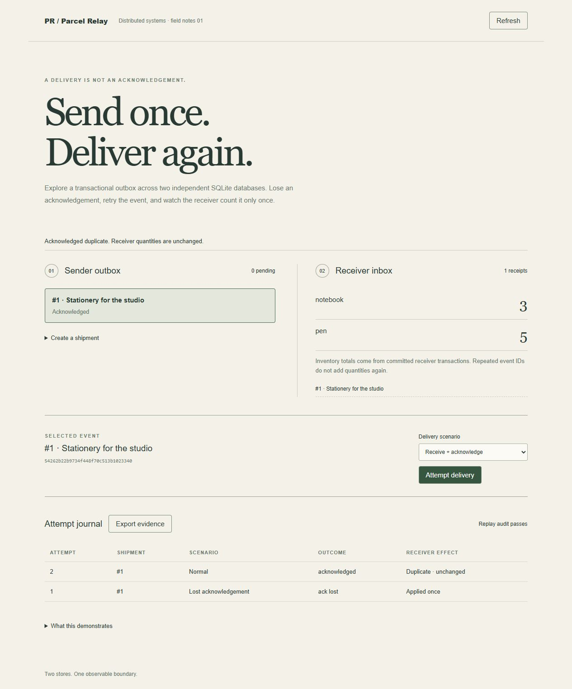

# Parcel Relay

A transactional-outbox workbench with two persistent SQLite databases, injected delivery failures, idempotent consumption, and replay evidence. Python standard library backend; dependency-free browser interface.



## Run

Requires Python 3.10 or newer. From this directory:

```sh
python run.py --port 8000
```

Open http://127.0.0.1:8000. Data persists in ignored `data/`; use `--data another-directory` for an independent workspace. No installation or external service required. Node 22+ is only needed for the JavaScript syntax check.

## Try the failure boundary

1. Expand **Create a shipment** and commit the fictional notebook/pen example.
2. Choose **Receive, then lose acknowledgement**, then attempt delivery. The receiver has 3 notebooks and 5 pens, but the sender still has one pending event.
3. Choose **Receive + acknowledge** and retry. The receiver recognizes the same ID, leaves inventory unchanged, and the sender records the acknowledgement.
4. Repeat delivery, or create another request with **New key**. **Fail before receiver** leaves its inventory unchanged. Export the snapshots and attempt history as JSON.

The same request key and normalized payload return the original shipment and event; different content returns HTTP 409. Item ordering does not change request identity.

## Guarantees and boundaries

`sender.sqlite3` commits the shipment and outbox row in one `BEGIN IMMEDIATE` transaction. `receiver.sqlite3` commits the unique inbox receipt and all SKU increments in another. Concurrent duplicate attempts serialize at the receiver and produce one inventory effect per retained event ID. Receiver failure rolls back both its receipt and any partial inventory updates.

Delivery is a local method call across separate databases, with explicit fault injection. This is not a broker deployment or an exactly-once transport claim. There is no distributed transaction, background worker, automatic retry, retry backoff, acknowledgement timeout, or ordering guarantee. Additive inventory effects happen to commute; this would not be sufficient for order-sensitive updates.

The lost-ack mode simulates the commit boundary without killing the process. A real crash can leave an attempt marked `started`; manually retrying the event is safe because its ID remains stable. A later failed attempt never clears an acknowledgement already recorded.

Each database snapshot is consistent independently. The combined page/export is not an atomic snapshot across both databases and may briefly show different moments during concurrent writes. The audit verifies event checksums and replays receiver totals. SHA-256 detects accidental corruption, not malicious edits by an administrator. There is no authentication or authorization; the server binds only to loopback.

Bounds: 200 shipments, 64 SKUs, 8 unique items per shipment, quantities 1–1,000, 2,000 attempts, 16 KB request bodies. Records are retained without expiry or deletion. For a backup, stop the server and copy the entire data directory, including any SQLite sidecar files.

## API

| Method | Path | Behavior |
| --- | --- | --- |
| GET | `/api/state` | Independent store snapshots, attempts, receiver totals, replay audit |
| POST | `/api/shipments` | `{key, memo, items: [{sku, quantity}]}`; 201 new or 200 replay |
| POST | `/api/events/{id}/deliver` | `{fault: "none"}`; also `before_receive` or `after_receive` |

Simulated delivery outcomes return HTTP 200 with a descriptive `status`; that does not imply successful acknowledgement. Invalid input is 400, missing event 404, conflicting identity 409. Assets use a fixed allowlist; cross-origin mutations are rejected.

## Verification

```sh
python -m unittest discover -s tests -v
npm run check
```

Ten tests cover source/receiver rollback with injected SQL failures, 16 concurrent identical creates, 20 concurrent duplicate deliveries, lost acknowledgements, reversed delivery order, persistence, conflicting IDs, checksum and projection corruption, HTTP lifecycle and request boundaries. CI runs Python 3.11/3.13 on Linux and Windows. Browser verification covers the lost-ack/retry workflow and exported inventory/hash evidence.

`store.py` contains transaction logic, `run.py` the HTTP boundary, and `app.js` the workbench. A useful extension is a separately deployed worker with durable leases, retry schedules, and retention policy; those features are deliberately not claimed here.
